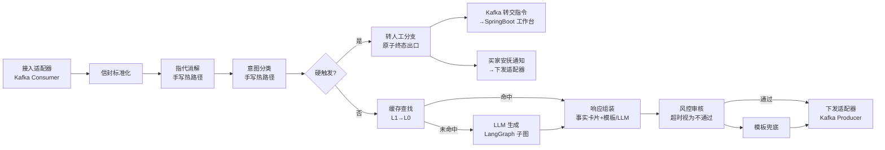

# Architecture Spine — 微聊首响 Agent

## Design Paradigm

**管道-过滤器**：买家消息经标准化信封（Envelope）流经处理管道，每个 hop 是独立过滤器，单一职责、可替换、可独立测试。管道为线性主链，过滤器之间禁止私有耦合，仅通过信封传递。

- **热路径过滤器**（指代消解 → 意图分类 → 路由 → 缓存查找 → 风控审核 → 响应组装 → 下发）手写纯 Python，毫秒级可控；
- **LLM 生成过滤器**内部为 LangGraph 子图（生成 + 后置审核 + 兜底切换），与热路径解耦；
- **编排方式**：单意图路由（每消息单一意图标签 → 唯一通道）；
- **转人工分支**：硬触发命中后跳转独立分支，原子终态出口，不回流主响应路径。



## Invariants & Rules

### AD-1 — 管道-过滤器架构 [ADOPTED]

- **Binds:** all
- **Prevents:** 过滤器间私有耦合（如生成过滤器直接调缓存内部方法），导致替换/测试困难
- **Rule:** 每个过滤器仅消费上游信封、产出下游信封；禁止跨过滤器直接函数调用；信封为单一 Pydantic 模型，含 session_id、house_id、turn、intent、timestamp、trace_id、message（买家原文）、resolved_message（消解后消息）、coref（引用元数据，可空）字段（见一致性约定）

### AD-2 — 热路径手写，LLM 子图 LangGraph [ADOPTED]

- **Binds:** 指代消解、意图分类、缓存查找、风控审核、响应组装、下发
- **Prevents:** 全图 LangGraph 编排引入的图调度开销侵蚀毫秒级延迟预算
- **Rule:** 热路径过滤器纯 Python 实现，不依赖 LangGraph Runtime；LLM 生成过滤器内部允许 LangGraph 子图，但对外仅暴露同步生成接口

### AD-3 — 单意图路由 [ADOPTED]

- **Binds:** FR-1, FR-2, FR-3, FR-4
- **Prevents:** 多意图扇出导致响应聚合复杂化与延迟不可控
- **Rule:** 意图分类仅消费消解后消息（resolved_message），输出单一标签 + 置信度分数；路由决策仅基于该标签；MVP 不拆分明细多意图消息，按置信度最高标签路由（多意图扇出 V2+）

### AD-4 — 会话状态单写者 [ADOPTED]

- **Binds:** FR-2, FR-5, FR-10
- **Prevents:** 多个过滤器并发写会话状态导致竞态与状态变更点发散
- **Rule:**
  - 会话状态（意图历史、追问计数、事实卡片引用、coref 结果、handoff 状态）仅由会话管理模块写入；过滤器只读并传 session_id；
  - 并发写（追问计数自增）用 Redis 原子操作或分布式锁；追问计数的权威值只存 Redis，任何进程内缓存（L1）不得作为判定依据；
  - handoff 状态为会话状态子字段，由会话管理模块在转人工分支写入，经纪人工作台侧展示状态以 Kafka 指令为准

### AD-5 — L1/L0 缓存分层与事实卡片模型

- **Binds:** FR-4, FR-5, SM-2
- **Prevents:** 缓存层职责重叠导致拦截率口径模糊与失效策略冲突
- **Rule:**
  - **L1 = cachetools.TTLCache 进程内缓存**：仅存会话级热点（最近意图、追问计数快照、handoff 状态快照），**不存事实卡片**；TTL ≤ 30s，允许短期不一致，进程内；追问计数快照仅作读优化，硬触发判定一律读 Redis 权威值；
  - **L0 = Redis 分布式缓存**：存事实卡片，key 结构为 `weiliao:l0:` 前缀 + 意图 + 房源 ID + 状态 + 价格分桶（段间以 `:` 分隔），TTL 5 分钟，房源状态变更时主动失效；
  - 事实卡片为单一 Pydantic 模型（见一致性约定），字段含房源状态、当前挂牌价（分桶到 10 万）、对口学校、最近 3 轮对话摘要；
  - 查找顺序：L1 → L0 → LLM；Follow-up Query 禁走 L0（FR-5）；
  - 缓存拦截率统计口径：L1 与 L0 命中均计入分子，基数为全部首次消息（重复追问不计入分母）；
  - 失效语义：逻辑作废（标记删除）非物理删除；Kafka 房源事件消费最大延迟 500ms，超期未消费事件按失效处理

### AD-6 — 事实卡片 Kafka 事件为唯一写入路径

- **Binds:** FR-4, 房源/价格数据一致性
- **Prevents:** 服务双写 DB 与缓存引入不一致窗口
- **Rule:** 房源状态、价格等事实变更以 Kafka 事件为权威写入路径；Redis 缓存由事件消费者更新/失效；服务不直写 DB；消费者侧最大事件延迟预算 500ms（超期触发告警）

### AD-7 — 转人工 Kafka 单向指令（原子终态）

- **Binds:** FR-3, SM-7
- **Prevents:** Python 侧重建双向 IM 连接，与 SpringBoot 经纪人工作台耦合；转人工流程被兜底机制吞没
- **Rule:**
  - 转人工 = Kafka 转交指令（→ SpringBoot 工作台）+ 买家安抚通知（→ 下发适配器），两个动作由转人工分支顺序执行，先指令后通知；
  - 转人工分支为原子终态出口，禁止回流至响应组装/下发路径，禁止在转人工分支使用模板兜底文案；
  - 指令发送失败时重试 3 次后写入死信队列并触发人工告警，禁止静默降级为模板应答；
  - 延迟 P99 < 5s

### AD-8 — 审核超时视为不通过

- **Binds:** FR-7, SM-1, SM-5
- **Prevents:** 风控中台超时导致响应阻塞，P99 超标
- **Rule:** 风控审核超时（默认值 500ms，可调区间 300-800ms）视为不通过，切换至模板兜底；服务不中断，延迟仍满足 P99 < 3s

### AD-9 — OpenAI 故障降级与恢复

- **Binds:** FR-8, SM-1, SM-3
- **Prevents:** OpenAI 配额耗尽或服务不可用导致服务中断；超时阈值与全链路 SLO 冲突
- **Rule:** OpenAI 返回 429/5xx/超时（> 1.8s）时自动切换模板兜底（切换时间 < 100ms）；恢复后按 10% 步进逐步切回；降级事件写 Langfuse trace 并触发监控告警；OpenAI 端到端预算 ≤ 1.8s（含 1 次重试，为全链路 P99 < 3s 倒推的有意从严，PRD FR-8 的 3s 超时阈值不冲突），LLM 过滤器内部重试 ≤ 1 次

### AD-10 — AI 身份披露 [ADOPTED]

- **Binds:** FR-9
- **Prevents:** Agent 伪装真人经纪人引发合规风险
- **Rule:** Agent 响应 100% 携带 AI 标识；转人工后标识切换为经纪人姓名/头像；Agent 生成文本不得包含"我是这套房的经纪人"或等价表述（风控审核范围）

### AD-11 — 指代消解前置过滤器 [ADOPTED]

- **Binds:** FR-11, FR-1, FR-2, FR-6
- **Prevents:** 意图分类、重复追问判定、LLM 生成各自回溯对话历史做消解，导致消解口径发散、延迟不可控
- **Rule:**
  - 指代消解为管道第一个热路径过滤器（信封标准化之后、意图分类之前），手写纯 Python；
  - 输出 = 消解后消息（自包含文本，唯一允许的内联标注格式为对齐 PRD 示例的"这套房（house_id: xxx）多少钱"式显式引用）+ 引用元数据，写入信封 resolved_message / coref 字段；
  - coref 引用元数据为单一 Pydantic 模型 `CorefRef` 的列表（0..n 条），权威定义在 models/；字段：entity_type（枚举：house/price/floor/location/other）、entity_id（house 类型必填 house_id，其余可空）；
  - 信封 coref 字段为下游唯一消费路径；Redis `coref:{turn}` 仅作审计留痕，禁止任何下游过滤器反读 Redis 重建 coref；
  - 意图分类（FR-1）、LLM 生成（FR-6）只消费消解后消息，禁止直接读取买家原始文本；重复追问判定（FR-2）以意图分类输出的意图标签为准（同义改写归并是分类器的职责），不直接对消解后消息做文本相似度比对；
  - 内联标注（如"house_id: xxx"）为内部表示，禁止出现在买家可见文本中；响应组装器下发前校验输出不含标注片段，风控审核将该校验纳入范围（与 AD-10 同列合规项）；
  - 消解锚定会话单一房源：先行词由会话状态确定，核心是归一化而非开放式实体链接；跨会话/跨房源指代不做（PRD §5）；
  - 无法确定先行词时保留原文进入意图分类，不阻塞、不转人工，由分类置信度与 UNKNOWN 既有路径承接；非房源实体指代（价格、楼层、位置等）尽力消解，失败按同一路径降级；
  - 延迟 P99 < 10ms；FR-1 的意图分类 50ms 预算为含消解的端到端口径；
  - 消解结果由会话管理模块写入会话状态（Redis），键：`weiliao:session:{session_id}:coref:{turn}`

### AD-12 — 硬触发评估集中归属 [ADOPTED]

- **Binds:** FR-3, SM-6, SM-7
- **Prevents:** 四类硬触发条件分散在多个过滤器各自评估，导致判定口径不一、漏判不可审计
- **Rule:**
  - 全部硬触发条件（红线意图、追问 ≥ 3 次、负面词汇命中、图片/语音输入）由 intent_router 过滤器内单一硬触发评估模块统一判定，判定结果（触发/未触发 + 命中条件）写入信封并记录 Langfuse trace；
  - 追问计数读 Redis 权威值（AD-4），不读 L1 快照；负面词汇词库由风控中台提供、服务内只读加载（词库 owner 见 Deferred，PRD OQ-3）；
  - 图片/语音输入由接入适配器在信封标注媒体类型（media_type: text/other），硬触发评估模块对非 text 直接判触发；意图分类、LLM 链路不处理非文本输入；
  - 硬触发命中即路由至转人工分支（AD-7），禁止任何过滤器在命中后继续走缓存/LLM 路径

## Consistency Conventions

| Concern | Convention |
| --- | --- |
| 命名（实体、文件、接口、事件） | 缓存 key：`weiliao:l0:` + 意图 + 房源 ID + 状态 + 价格分桶；会话 key：`weiliao:session:` + session_id + `:intent:` + turn，消解结果键：`weiliao:session:` + session_id + `:coref:` + turn；Kafka topic 语义命名（如 `house.sync.trigger`） |
| 数据格式 | 消息信封统一为单一 Pydantic 模型，字段：session_id、house_id、turn、intent、timestamp、trace_id（Langfuse）、message（买家原文）、resolved_message（消解后消息）、coref（引用元数据，可空）、media_type（text/other，接入适配器赋值）；意图标签为单一 `Literal` 类型枚举（GREETING/PRICE_INQUIRY/AVAILABILITY/LOCATION/PHOTO_REQUEST/NEGOTIATION/LOAN_POLICY/COMPLAINT/UNKNOWN），全链路 `model_validate` 校验，未知值 fail-closed 到模板兜底；`turn` 定义为会话内绝对消息序号，由会话管理模块在消息入管道前赋值；Redis 值用 JSON 序列化 |
| 事实卡片 schema | 单一 Pydantic 模型：`house_id`、`status`（active/sold/offline）、`price_bucket`（10 万分桶）、`school`（可选）、`dialogue_summary`（最近 3 轮）、`fact_version`（int，Kafka 事件单调递增）、`as_of`（timestamp） |
| 状态变更 | 会话状态仅会话管理模块写；追问计数 Redis 原子自增；事实卡片由 Kafka 消费者写；coref 结果由指代消解过滤器产出、会话管理模块写；handoff 状态由转人工分支触发会话管理模块写 |
| 错误处理 | 所有过滤器捕获异常后降级至模板兜底；转人工分支除外（见 AD-7）；禁止将未审核内容发买家；错误响应携带 trace_id |
| 可观测 | Langfuse trace_id 贯穿全链路；每消息记录三文本字段：买家原文、消解后消息、最终下发文本（审核与 SM-5/SM-6 验收的统一数据源）；降级事件、审核结果、缓存命中、硬触发命中条件均记录 trace；成本追踪记录 token 消耗与模型调用费用 |
| 运维 | 健康检查端点挂在响应组装过滤器（`GET /health`，返回 200 表示服务就绪）；Langfuse 成本追踪指标纳入监控面板；SM-5/SM-6 验收口径以 Langfuse trace 数据为准 |

## Stack

| Name | Version | 备注 |
| --- | --- | --- |
| Python | ≥3.11 | |
| FastAPI | ≥0.115.0 | 下限已核实存在；最新版以 PyPI 为准（2026-10-23 核实为 0.161.1） |
| Uvicorn | ≥0.32.0 | 截至 2026-10-22 经 PyPI 核实最新 0.54.0 |
| Pydantic | ≥2.9.0 | 截至 2026-10-22 经 PyPI 核实最新 2.14.1 |
| LangGraph | 1.2.16 | LLM 子图编排 |
| LangChain-OpenAI | ≥1.6.2 | 截至 2026-10-22 经 PyPI 核实最新 1.7.2 |
| redis-py | 8.1.0 | L0 缓存客户端 |
| Langfuse SDK | 5.0.4 | 全链路 trace 与成本追踪 |
| cachetools | 7.2.4 | L1 进程内缓存（TTLCache） |
| OpenAI API | gpt-4o / gpt-4o-mini | API 级模型名；**经 OpenAI 官方弃用公告核实（2026-10-14 通知）：gpt-4o 全系列（含 mini）将于 2027-01-14 从 API 关停，官方替代 gpt-6-luna**；模型名经配置注入（alias 指向当前快照，禁硬编码），迁移路径见 Deferred |

注：既有 my-agent 脚手架（anthropic、a2a-sdk、postgres checkpoint、sse-starlette）为无关原型依赖，本架构不复用、不继承。

## Structural Seed

```text
首响 Agent 服务（Python，独立部署）
  adapters/          # Kafka consumer/producer、外部服务适配
  filters/           # 热路径过滤器：coreference（指代消解，管道首位）, intent_router, cache_lookup, risk_review, response_assembler
  llm/               # LangGraph 子图、OpenAI client、prompt 管理
  session/           # 会话状态管理（单写者，含 handoff 状态）
  cache/             # L0 Redis 客户端、L1 cachetools 封装
  models/            # Pydantic 模型：信封、事实卡片、意图标签（Literal）
  workers/           # Kafka 消费者：房源事件同步、转人工指令
  observability/     # Langfuse trace、监控指标、成本追踪
  health/            # 健康检查端点（挂在响应组装过滤器）
```

## Capability → Architecture Map

| Capability / Area | Lives in | Governed by |
| --- | --- | --- |
| 指代消解（FR-11） | filters/coreference | AD-1, AD-2, AD-11 |
| 意图识别与路由（FR-1/2/3） | filters/intent_router（含硬触发评估模块） | AD-1, AD-2, AD-3, AD-12 |
| L0 缓存与事实卡片（FR-4/5） | cache/, workers/house_sync | AD-4, AD-5, AD-6 |
| LLM 生成与风控（FR-6/7/8） | llm/, filters/risk_review | AD-2, AD-8, AD-9 |
| AI 身份披露（FR-9） | filters/response_assembler | AD-10 |
| 会话状态管理（FR-10） | session/ | AD-4 |

## Deferred

- **意图分类器具体选型**（规则引擎 / gpt-4o-mini zero-shot / 微调小模型）——第 2 周据语料标注决定（PRD OQ-1），脊柱仅定接口边界（AD-3 单意图路由）
- **指代消解实现选型**（规则模板归一化 / 轻量序列标注模型 / LLM 改写）——第 2 周与 OQ-1 一同据语料标注决定（PRD OQ-5），脊柱仅定接口边界（AD-11）；LLM 改写方案须另行论证其 10ms 延迟预算可行性
- **部署拓扑**（K8s vs 公司 PaaS、实例水平扩展、可用区冗余）——待运维/架构评审决策，逻辑架构保持实例无状态、任意实例可处理任意消息，L1 仅为优化层不影响正确性
- **多级模型降级链**（DeepSeek / Qwen）——V2 范围（PRD §5）
- **软触发置信度转人工**——V2 范围（PRD §5）
- **会话历史摘要生成**（经纪人工单增强）——V2 范围（PRD §4.2 FR-3 Out of Scope）
- **主模型迁移**（gpt-4o → gpt-6-luna）——2027-01-14 关停前完成替代模型验证与灰度（PRD FR-8 恢复步进机制复用）；意图分类选型（OQ-1）与消解实现（OQ-5）若倾向 LLM 方案须以替代模型重新论证
- **负面词汇硬触发词库 owner**——PRD OQ-3，待与客服团队确认；脊柱已定机制落点（AD-12 从风控中台只读加载），owner 不影响接口边界
- **风控中台 QPS 上限与本地敏感词前置层**——PRD OQ-2，待风控中台确认容量后再决；若需前置层，其词库同步路径复用 AD-6 Kafka 事件模式
